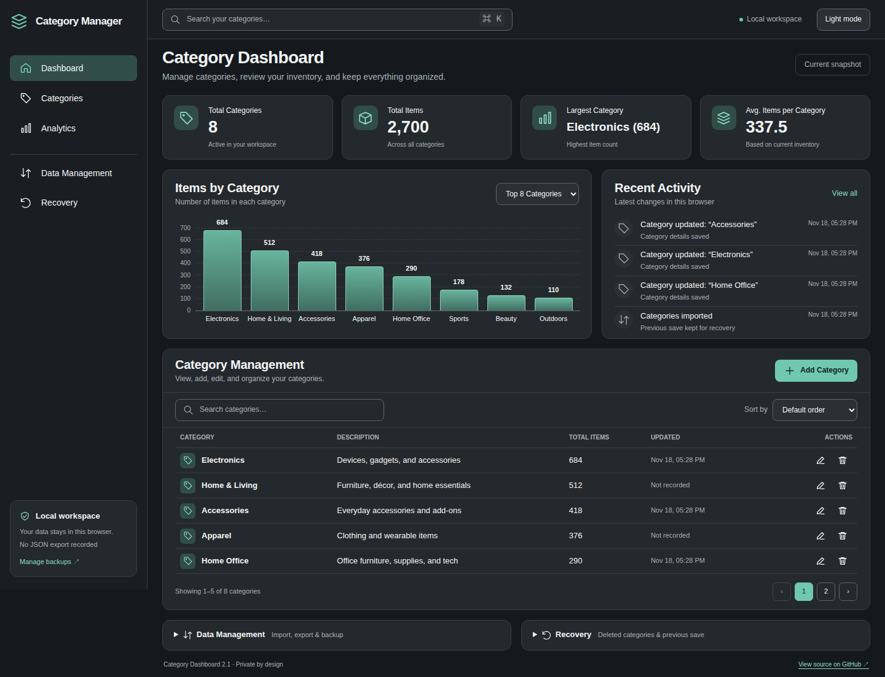

# Category Dashboard 2.1 — visual review

A small, dependable category manager built with **HTML, CSS, and vanilla JavaScript**. Organize categories, track totals, and keep control of your data without accounts, analytics, or a backend.

[Live dashboard](https://givi588.github.io/category-dashboard/) · [Checks](https://github.com/givi588/category-dashboard/actions/workflows/javascript-tests.yml) · [Testing](TESTING.md) · [Data & recovery](docs/DATA.md)

## Features

- Add, edit, search, and sort categories; see totals, largest category, average items, and item-count bars.
- Persistent **Recently deleted** list with individual restore and confirmed permanent removal.
- **Back up JSON** for an exact copy of active and deleted categories; import JSON to restore it.
- CSV report export with formula neutralization; validated CSV import with confirmation.
- One **previous save** before every successful mutation, including imports.
- Safe migration from the original `categories` storage key without modifying that key.
- Errors remain visible; corrupt data, quota failures and stale tabs do not silently replace the saved list.
- Responsive light/dark themes, keyboard navigation, explicit form labels, invalid-field feedback, and live status messages.

A compact graphite and mint workspace brings together overview cards, category analytics, management, backup, and recovery. A collapsible mobile sidebar supports keyboard navigation and Escape. New visitors start in dark mode; saved light/dark preferences remain unchanged. No runtime dependencies, web fonts, external APIs, or decorative animations.

## Start using it

1. Open the [live dashboard](https://givi588.github.io/category-dashboard/).
2. Use **Add Category** or a row’s **Edit** button to open the category editor. Search and sorting affect the list, not totals.
3. Use **Back up JSON** regularly and keep the downloaded file somewhere safe.
4. To undo a deletion, use **Restore** under Recently deleted. To undo the last change/import, expand **Data recovery → Restore previous save**.

Data belongs to this browser and origin. **Clearing site data or losing the device also removes the local recovery copies.** There is no cross-device synchronization. This is a finished portfolio application, not a multi-user database or an encrypted vault.

## Interface

The 2.1 branch is a review candidate. **Production remains on 2.0 until explicit owner approval.** Screenshots and results for 2.1 are documented in [the visual review report](docs/VISUAL-REVIEW-v2.1.md). The captures below show the 2.1 review candidate using explicitly imported sample inventory in an isolated test workspace.



[Mobile dark](screenshots/v2.1-mobile-dark.png) · [Desktop light](screenshots/v2.1-desktop-light.png) · [Mobile light](screenshots/v2.1-mobile-light.png)

Actual Chromium screenshots from the 2.1 browser suite. The full suite captures 320, 375, 768, and 1440 pixel layouts in both themes.

The `screenshots/v1-*` and `screenshots/v2-*` files retain the historical 1.0 and 2.0 interfaces.

## Develop locally

Use Node.js 22.12+ (CI uses Node 24):

```sh
npm ci
npm run check
npm test
npm run build
npm start
```

Open `http://127.0.0.1:8080`. Use HTTP instead of opening `index.html` as a file: browser storage behavior for `file:` URLs varies. The deployed site requires no build service or Node runtime.

For the browser suite:

```sh
npx playwright install --with-deps chromium firefox webkit
npm run build
npm run test:e2e
```

The suite starts its own server on port 8080. It uses isolated browser contexts and synthetic data; it does not touch your live browser data. Reports are in `playwright-report/` and screenshots/traces in `test-results/` (ignored by Git).

## Architecture

| File | Responsibility |
| --- | --- |
| `index.html` | Semantic page structure and labeled controls |
| `style.css` | Responsive layout, themes, focus and error states |
| `data.js` | Validation, storage transactions, recovery and CSV/JSON codecs; shared with Node tests |
| `script.js` | DOM rendering, forms, download/upload interactions and theme preference |
| `activity.js` | Optional bounded local event history, isolated from category storage |
| `navigation.js` | Collapsible sidebar, anchor navigation and keyboard focus; no storage writes |
| `scripts/build.cjs` | Copies only public application files into `dist/` |
| `tests/*.test.cjs` | Domain and simulated-DOM regression tests |
| `tests/e2e/dashboard.spec.cjs` | Real Chromium, Firefox and WebKit browser checks |
| `.github/workflows/javascript-tests.yml` | Runs syntax, unit, build and browser checks on pushes and pull requests |

## Validation and release

See [TESTING.md](TESTING.md) for the actual verification record and remaining limits. Automated accessibility scans are useful checks, not a certification of complete accessibility. The browser suite covers 320, 375, 768 and 1440 px widths in both themes.

GitHub Actions runs syntax, unit, build and browser checks. GitHub Pages serves the static root `index.html`; release packaging is handled separately after verification.

## Data limits

Names: 1–30 characters after trimming, unique without regard to case within each list. Descriptions: at most 120 characters. Item counts: whole numbers from 0 to 1,000,000. At most 1,000 active and 1,000 deleted categories; total serialized storage/import limit: 1 MB. Limits are JavaScript string lengths, not grapheme counts. See [data documentation](docs/DATA.md) for CSV tradeoffs, migration, concurrency and recovery details.

## 2.0 compatibility

`data.js` is unchanged. The `category-dashboard:v1`, `category-dashboard:previous`, `categories`, and `theme` keys retain their existing meaning. Opening the redesigned interface does not write category data or migrate saved records. Backup and transfer controls now live in **Data management**; recently deleted entries and previous-save tools are in **Recovery**.

## Review 2.1 locally

```sh
git fetch origin
git switch feature/dashboard-v2-1-visual
npm ci
npm run build
npm start
```

Open `http://127.0.0.1:8080` in a separate browser profile for an isolated review. GitHub Pages stays unchanged. No preview deployment is configured for this repository.

### New interface

- Compact graphite and mint layout based on the approved reference.
- Four actual statistics, including average items per category (one decimal place).
- Vertical chart with Top 8 / All Categories controls; horizontal scrolling stays inside the chart on narrow screens.
- Semantic category table, five-row pagination, synchronized header/table search, and sorting.
- Native modal editor with keyboard focus containment, Escape cancellation and focus restoration.
- Collapsible data management and recovery panels, accessible from the sidebar.
- Genuine local activity, starting with actions taken in 2.1. No historical growth or fictional accounts.

### Activity and update information

The optional `category-dashboard:activity:v1` log retains the latest 100 events. It is separate from the unchanged category data format and is written only after successful actions. Existing or malformed history is never reset on load. If the log is corrupt or cannot be saved, category operations remain independent and a history warning is displayed. The log is not part of CSV or category JSON backups.

Updated timestamps appear only for matching category snapshots recorded in the retained log. Imported/recovered categories without a subsequent recorded edit show **Not recorded**. JSON export status means that a download was requested; browsers cannot verify that a file was retained on disk.
