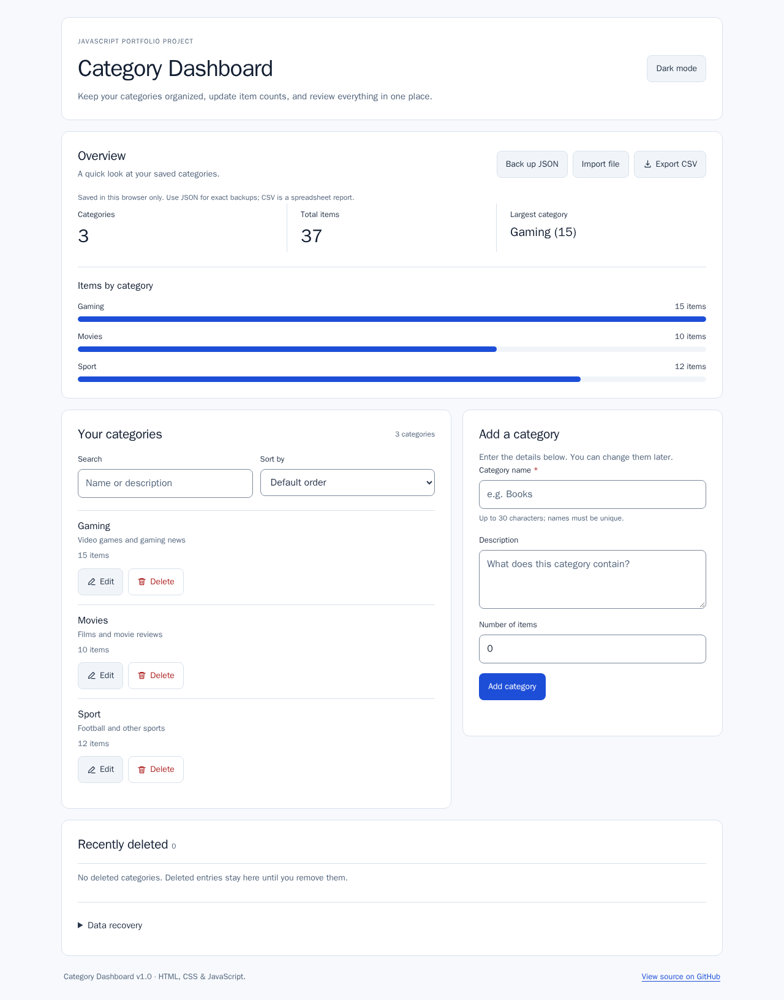

# Category Dashboard v1.0

A small, dependable category manager built with **HTML, CSS, and vanilla JavaScript**. Organize categories, track totals, and keep control of your data without accounts, analytics, or a backend.

[Live dashboard](https://givi588.github.io/my-first-website/) · [Checks](https://github.com/givi588/my-first-website/actions/workflows/javascript-tests.yml) · [Testing](TESTING.md) · [Data & recovery](docs/DATA.md)

## Features

- Add, edit, search, and sort categories; see totals, largest category, and item-count bars.
- Persistent **Recently deleted** list with individual restore and confirmed permanent removal.
- **Back up JSON** for an exact copy of active and deleted categories; import JSON to restore it.
- CSV report export with formula neutralization; validated CSV import with confirmation.
- One **previous save** before every successful mutation, including imports.
- Safe migration from the original `categories` storage key without modifying that key.
- Errors remain visible; corrupt data, quota failures and stale tabs do not silently replace the saved list.
- Responsive light/dark themes, keyboard navigation, explicit form labels, invalid-field feedback, and live status messages.

The visual design retains neutral surfaces, one accent color, and simple spacing. No runtime dependencies, web fonts, external APIs, or decorative animations.

## Start using it

1. Open the [live dashboard](https://givi588.github.io/my-first-website/).
2. Add or edit categories using the form. Search and sorting affect the list, not totals.
3. Use **Back up JSON** regularly and keep the downloaded file somewhere safe.
4. To undo a deletion, use **Restore** under Recently deleted. To undo the last change/import, expand **Data recovery → Restore previous save**.

Data belongs to this browser and origin. **Clearing site data or losing the device also removes the local recovery copies.** There is no cross-device synchronization. This is a finished portfolio application, not a multi-user database or an encrypted vault.

## Interface



[Mobile screenshot at 320px](screenshots/v1-mobile.png). These are actual browser screenshots of the application, not design mockups.

## Develop locally

Use Node.js 22.12+ (CI uses Node 24):

```sh
npm ci
npm run check
npm test
npm run build
npm start
```

Open `http://127.0.0.1:8080`. Use HTTP instead of opening `index.html` as a file: browser storage behavior for `file:` URLs varies. The deployed site requires no build service or Node runtime.

For the browser suite:

```sh
npx playwright install --with-deps chromium firefox webkit
npm run build
npm run test:e2e
```

The suite starts its own server on port 8080. It uses isolated browser contexts and synthetic data; it does not touch your live browser data. Reports are in `playwright-report/` and screenshots/traces in `test-results/` (ignored by Git).

## Architecture

| File | Responsibility |
| --- | --- |
| `index.html` | Semantic page structure and labeled controls |
| `style.css` | Responsive layout, themes, focus and error states |
| `data.js` | Validation, storage transactions, recovery and CSV/JSON codecs; shared with Node tests |
| `script.js` | DOM rendering, forms, download/upload interactions and theme preference |
| `scripts/build.cjs` | Copies only public application files into `dist/` |
| `tests/*.test.cjs` | Domain and simulated-DOM regression tests |
| `tests/e2e/dashboard.spec.cjs` | Real Chromium, Firefox and WebKit browser checks |
| `.github/workflows/javascript-tests.yml` | Checks on branches/PRs, with test reports; gated v1.0 release on main |

## Validation and release

See [TESTING.md](TESTING.md) for the actual verification record and remaining limits. Automated accessibility scans are useful checks, not a certification of complete accessibility. The browser suite covers 320, 360, 768 and 1280 px widths in both themes.

The release workflow only publishes `v1.0.0` after the main-branch test job passes. Existing GitHub Pages hosting continues to serve the root `index.html`; the release ZIP contains only deployable files from `dist/`.

## Data limits

Names: 1–30 characters after trimming, unique without regard to case within each list. Descriptions: at most 120 characters. Item counts: whole numbers from 0 to 1,000,000. At most 1,000 active and 1,000 deleted categories; total serialized storage/import limit: 1 MB. Limits are JavaScript string lengths, not grapheme counts. See [data documentation](docs/DATA.md) for CSV tradeoffs, migration, concurrency and recovery details.
