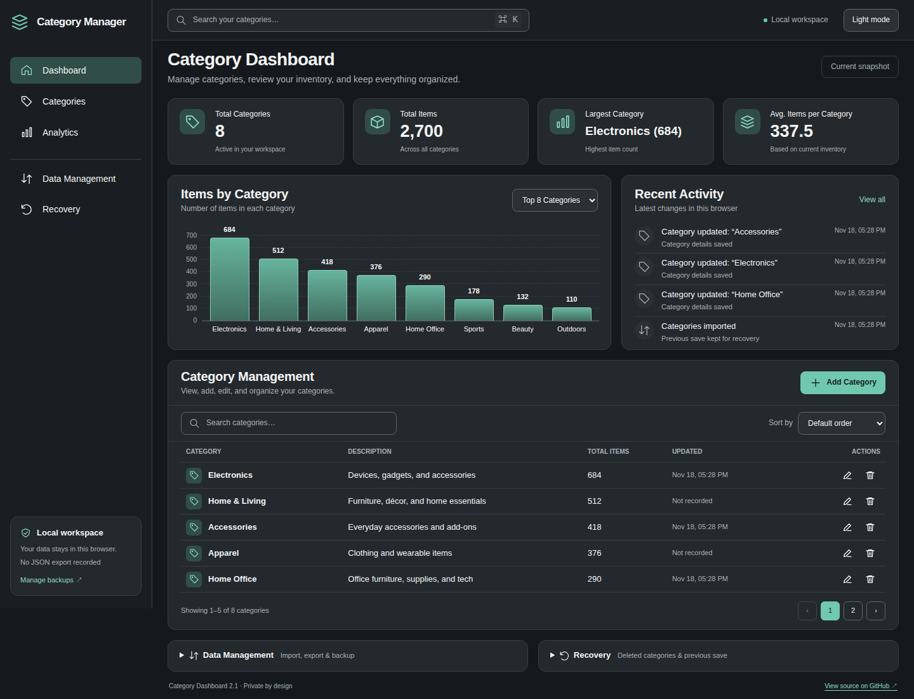

# Category Dashboard 2.1 visual review

This branch is a review candidate. It must not be merged or deployed to production until the owner approves the actual screenshots. The published 2.0 application is unchanged.

## Review the implementation

1. Open pull request #2 and inspect the screenshots below.
2. Check out `feature/dashboard-v2-1-visual`, run `npm ci`, `npm run build`, and `npm start`.
3. Open `http://127.0.0.1:8080` in a separate browser profile. This keeps the review workspace separate from existing localhost data.
4. Try Add Category, Edit, Delete, search, all sort modes, pagination, both themes, and the mobile menu.
5. Open Data Management for CSV/JSON import/export; open Recovery for deleted categories and previous-save restoration.

No hosted preview is configured. Local review does not change GitHub Pages.

## Actual application screenshots

[Desktop light](../screenshots/v2.1-desktop-light.png) · [Mobile dark, 375 px](../screenshots/v2.1-mobile-dark.png) · [Mobile light, 375 px](../screenshots/v2.1-mobile-light.png) · [Narrow mobile, 320 px](../screenshots/v2.1-mobile-320.png) · [Tablet, 768 px](../screenshots/v2.1-tablet.png) · [Category editor](../screenshots/v2.1-editor.png)

These are browser captures of the implemented application, not generated mockups. The reference-comparison test explicitly imports eight sample categories into an isolated browser context, then performs actual edits through the UI. The counts sum to **2,700**, so the average is **337.5**. The reference illustration's 2,480 total and growth percentages are not copied. Default and empty-workspace behavior is tested separately. No sample inventory is inserted into existing user storage.

## Reference comparison and iteration

The implementation follows the reference's 240 px sidebar, compact 64 px header, four-card statistics row, approximately 1.6:1 chart/activity split, graphite surfaces, restrained mint controls, outline icons, and wide category table.

The first browser captures were inspected at desktop and mobile sizes. Review identified overly tall table rows, undersized chart labels, non-rounded chart ticks, and a screenshot scroll-position artifact after accessibility scanning. The second iteration reduced row padding, strengthened section headings, increased chart label/plot sizing, introduced readable tick intervals and a restrained teal bar treatment, and normalized capture position. Mobile activity timestamps wrap below the event text, and the initial mobile table included a horizontal-scroll hint. A further review corrected clipping above the tallest bar, expanded chart-label room, and tightened activity rows. Browser checks also found and corrected activity-region keyboard scrolling, an asynchronous editor-save race, and reverse keyboard traversal in the editor.

Functional differences from the illustration are intentional:

| Reference decoration | Implemented behavior |
| --- | --- |
| Products, Reports, Team, fictional account and notifications | Only working category, analytics, data and recovery navigation |
| Subscription panel | Actual local workspace and JSON export-request status |
| Growth percentages and date filter | Current totals, largest category, average; no invented time series |
| Historical update dates | Recorded timestamps for matching category snapshots; otherwise “Not recorded” |
| Fictional recent events | Actions successfully performed in this browser after upgrading |
| Large desktop table | Below 600 px each row becomes a card with the item count and 44 px Edit/Delete controls in view |

The layout is closely reference-led, not a claim of pixel identity: real category names, browser typography, accurate metrics and required data tools affect the result.

## Data compatibility

`data.js` is unchanged from main. Existing category, previous-save, legacy and theme keys retain their formats. Opening 2.1 does not write category data. The optional `category-dashboard:activity:v1` log records at most 100 new events and does not alter category records or backup files. Invalid or future-version history is preserved and reported, while category saves remain independent. There is no historical backfill.

## Verification

**Passed:** dependency installation, syntax checks, 43 unit tests, build, and 63 browser scenarios across Chromium, Firefox and WebKit. [Verified implementation run](https://github.com/givi588/category-dashboard/actions/runs/44287927590). See [TESTING.md](../TESTING.md) for commands, browser coverage, CI evidence and remaining verification limits. Tests run against isolated synthetic data, never the production user's browser storage.
